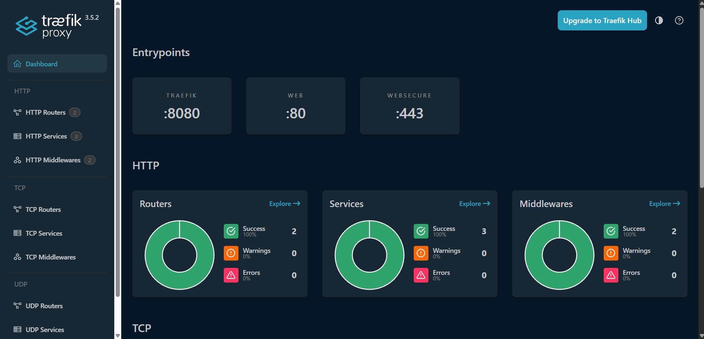
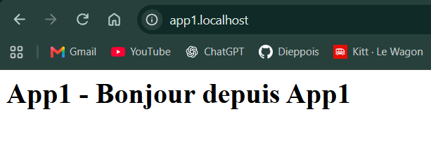
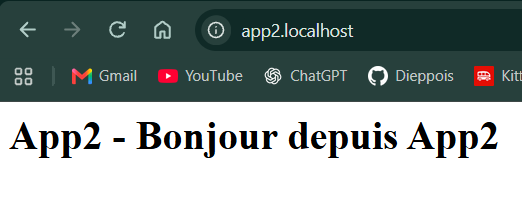
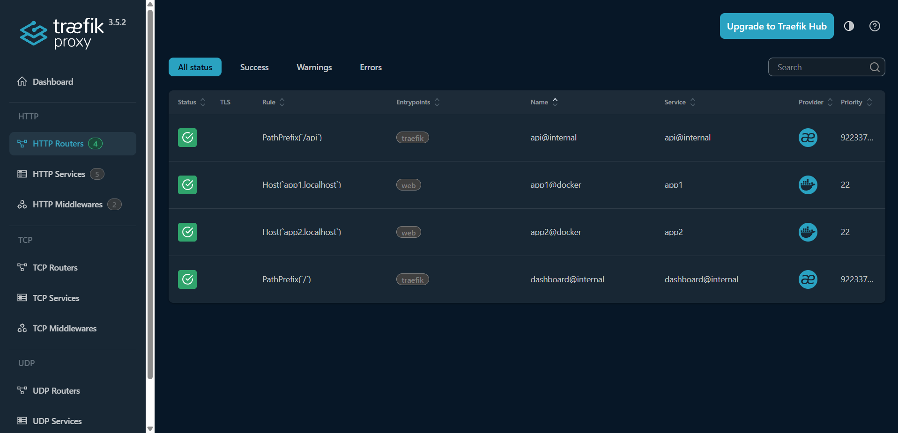
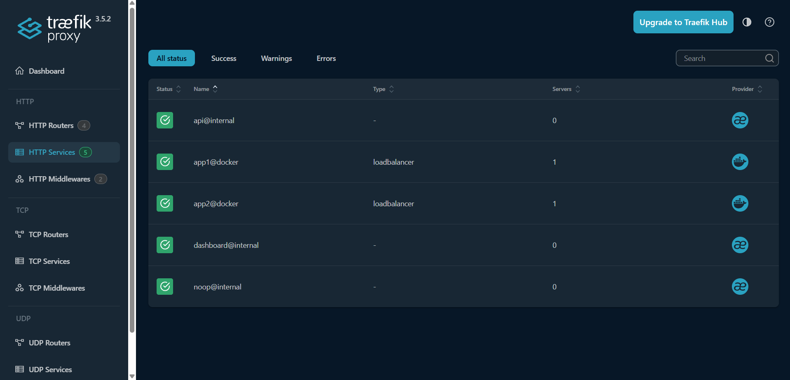
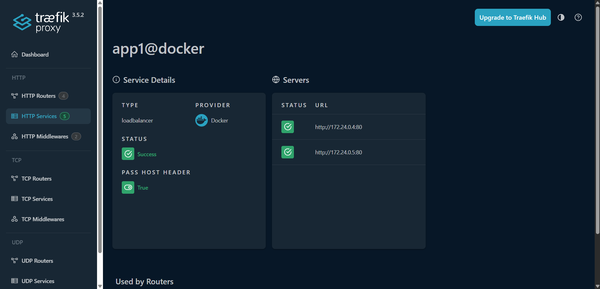
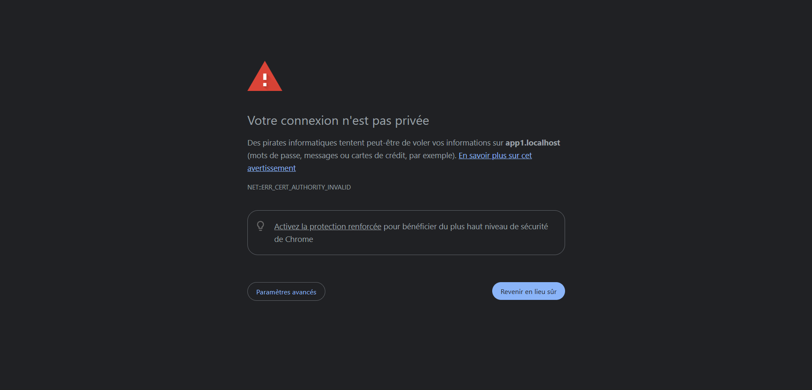
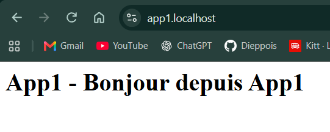

# TP5 : Reverse Proxy et Load Balancing avec Traefik

## 1. Prérequis

| Outil | Version |
|---|---|
| Docker | 28.5.1 |
| Docker Compose | v2.40.2 |
| curl | 8.16.0 |

Ports 80, 443 et 8080 libres sur l'hôte.

```bash
docker --version
docker compose version
curl --version
```

## 2. Structure du projet

```
.
├── docker-compose.yml
├── config/traefik.yaml
├── app1/index.html
└── app2/index.html
```

```bash
mkdir -p config app1 app2
echo '<h1>App1 - Bonjour depuis App1</h1>' > app1/index.html
echo '<h1>App2 - Bonjour depuis App2</h1>' > app2/index.html
```

Les dossiers `app*/` ne contiennent que des fichiers servis. Aucun secret, `.env` ou clé privée.

## 3. Phase 1 : Déployer Traefik

**Réseau partagé** `frontend` : Traefik joint les applications sans publier leurs ports sur l'hôte.

```bash
docker network create frontend
```

**Configuration statique** [config/traefik.yaml](config/traefik.yaml) : logs DEBUG, dashboard actif, entrypoints `web` (:80) et `websecure` (:443).

**Compose** [docker-compose.yml](docker-compose.yml) : image `traefik:v3.5.2`, socket Docker en `ro`, dashboard lié à `127.0.0.1:8080`.

```bash
docker compose up -d
docker ps
docker logs traefik-1
```

Résultat : conteneur `traefik-1` démarré, dashboard accessible sur http://localhost:8080/dashboard/ (HTTP 200).

| Port hôte | Usage |
|---|---|
| 0.0.0.0:80 | entrypoint web |
| 0.0.0.0:443 | entrypoint websecure |
| 127.0.0.1:8080 | dashboard et API (local uniquement) |



**Sécurité**
- `api.insecure: true` : lab uniquement, à désactiver en production.
- `docker.sock:ro` ne rend pas l'API Docker en lecture seule. En production, passer par un proxy de socket filtré.

## 4. Phase 2 : Découverte automatique Docker

Ajout du provider Docker dans [config/traefik.yaml](config/traefik.yaml) :

```yaml
providers:
  docker:
    endpoint: "unix:///var/run/docker.sock"
    exposedByDefault: false
    network: frontend
```

- `exposedByDefault: false` : seul un conteneur avec `traefik.enable=true` est routé.
- `network: frontend` : réseau utilisé pour joindre les backends.

Config statique modifiée, donc redémarrage explicite :

```bash
docker compose restart traefik
docker logs traefik-1
```

Résultat dans les logs :

```
Provider connection established with docker 28.5.1
Filtering disabled container container=db-family-recipes-...
```

Un conteneur sans label (`db-family-recipes`) est ignoré : aucune route créée.

## 5. Phase 3 : Deux applications Nginx

Ajout de `app1` et `app2` dans [docker-compose.yml](docker-compose.yml) : image `nginx:stable`, contenu monté en `ro`, réseau `frontend`, aucune section `ports`.

| Label | Rôle |
|---|---|
| `traefik.enable=true` | autorise l'exposition par Traefik |
| `routers.app1.rule=Host(...)` | règle sur le nom d'hôte |
| `routers.app1.entrypoints=web` | router lié à l'entrée HTTP :80 |
| `services.app1.loadbalancer.server.port=80` | port interne du conteneur (pas de l'hôte) |

```bash
docker compose up -d
docker ps
```

Résultat :

```
NAMES        PORTS
nginx-app2   80/tcp
nginx-app1   80/tcp
traefik-1    0.0.0.0:80->80/tcp, 0.0.0.0:443->443/tcp, 127.0.0.1:8080->8080/tcp
```

Les Nginx affichent `80/tcp` sans `->` : aucun port applicatif publié sur l'hôte. Seul Traefik est joignable.

## 6. Phase 4 : Routage HTTP

```bash
curl http://app1.localhost
curl http://app2.localhost
curl -H "Host: app1.localhost" http://localhost
curl -H "Host: app2.localhost" http://localhost
```

| Requête | Réponse |
|---|---|
| `app1.localhost` | `App1 - Bonjour depuis App1` |
| `app2.localhost` | `App2 - Bonjour depuis App2` |
| `Host: app1.localhost` sur `localhost` | `App1 - Bonjour depuis App1` |
| `Host: app2.localhost` sur `localhost` | `App2 - Bonjour depuis App2` |




**Pourquoi le même port mène à deux applications ?** Traefik lit l'en-tête `Host` et choisit le router dont la règle `Host(...)` correspond.

**Tests de refus**

| Test | Résultat |
|---|---|
| Hôte inconnu (`Host: inconnu.localhost`) | 404, aucune application atteinte |
| `docker port nginx-app1` / `nginx-app2` | vide, aucun port publié |
| Accès direct `localhost:8081` | connexion refusée |
| Routers via API | `app1@docker`, `app2@docker` uniquement, pas de route pour `db-family-recipes` |

Test depuis une machine non autorisée : non réalisé (lab mono-poste). Le dashboard étant lié à `127.0.0.1`, il n'est pas joignable depuis le réseau.

Un 404 ne prouve pas à lui seul que l'architecture est sécurisée. La règle `Host(...)` sélectionne une application, elle n'authentifie personne.

## 7. Phase 5 : Dashboard et API

```bash
curl http://localhost:8080/api/http/routers
curl http://localhost:8080/api/http/services
```

**Routers**

| Nom | Règle | Entrypoint | Service | État |
|---|---|---|---|---|
| app1@docker | Host(`app1.localhost`) | web | app1 | enabled |
| app2@docker | Host(`app2.localhost`) | web | app2 | enabled |

**Services**

| Nom | Backend | État |
|---|---|---|
| app1@docker | http://172.24.0.4:80 | enabled |
| app2@docker | http://172.24.0.3:80 | enabled |

Les entrées `@internal` (api, dashboard, noop) sont propres à Traefik.




**Router vs service ?** Le router décide où va une requête (règle + entrypoint). Le service est la destination : il liste les backends vers lesquels Traefik transmet.

L'API expose les IP internes des conteneurs : elle doit être protégée autant que le dashboard.

## 8. Phase 6 : Load Balancing

Ajout d'une deuxième instance `app1b` avec une page distincte :

```bash
mkdir -p app1b
echo '<h1>Bonjour depuis App1 - Instance B</h1>' > app1b/index.html
docker compose up -d
```

Dans [docker-compose.yml](docker-compose.yml), `app1b` reprend exactement les mêmes noms de router et de service que `app1` (`routers.app1`, `services.app1`). Traefik regroupe les deux conteneurs dans le service logique `app1`.

```
Client → Traefik → Router app1.localhost → Service app1 → nginx-app1 (172.24.0.4)
                                                        → nginx-app1b (172.24.0.5)
```

Service `app1@docker` via l'API : 2 serveurs, tous deux `UP`.

```bash
for i in $(seq 1 10); do curl -s http://app1.localhost; done
```

Résultat : alternance stricte, 5 réponses App1 et 5 réponses Instance B (round robin, stratégie par défaut).



**Routage vs Load Balancing :** le routage choisit l'application (règle `Host`). Le Load Balancing choisit une instance parmi celles de cette application.

## 9. Phase 7 : HTTPS et TLS

Ajout d'un router HTTPS sur `app1` dans [docker-compose.yml](docker-compose.yml) :

```yaml
- "traefik.http.routers.app1-secure.rule=Host(`app1.localhost`)"
- "traefik.http.routers.app1-secure.entrypoints=websecure"
- "traefik.http.routers.app1-secure.tls=true"
```

Le router `app1-secure` pointe vers le service `app1` existant (2 instances).

| Test | Résultat |
|---|---|
| `curl https://app1.localhost` | échec, `SEC_E_UNTRUSTED_ROOT` (code 60) |
| `curl -k https://app1.localhost` | page servie |
| Certificat présenté | `CN=TRAEFIK DEFAULT CERT`, auto-signé |
| Navigateur | `NET::ERR_CERT_AUTHORITY_INVALID` |



**TLS activé ≠ certificat valide.** Le flux est chiffré, mais le client ne peut pas vérifier l'identité du serveur : sans certificat signé par une autorité de confiance, un attaquant peut présenter son propre certificat. `curl -k` ignore cette vérification, ce n'est pas une validation.

Pour un certificat valide :
- lab : autorité locale approuvée par le poste (ex. mkcert) ;
- public : resolver ACME (Let's Encrypt) avec un vrai domaine.

À prévoir ensuite : TLS 1.2 minimum, redirection HTTP vers HTTPS une fois HTTPS validé, HSTS seulement quand le HTTPS est durable. Le flux Traefik vers Nginx reste en HTTP clair.

### Certificat valide avec mkcert

Autorité locale approuvée par le poste :

```bash
winget install FiloSottile.mkcert
mkcert -install
mkcert -cert-file certs/app1.pem -key-file certs/app1-key.pem app1.localhost
```

Certificat fourni via le provider `file` :
- [config/traefik.yaml](config/traefik.yaml) : `providers.file.directory: /etc/traefik/dynamic`
- [config/dynamic/tls.yaml](config/dynamic/tls.yaml) : déclare `app1.pem` et `app1-key.pem`
- [docker-compose.yml](docker-compose.yml) : montage `./config/dynamic` et `./certs` en `ro`
- [.gitignore](.gitignore) : `certs/` exclu du dépôt (clé privée)

| Test (sans `-k`) | Résultat |
|---|---|
| `curl --ssl-no-revoke https://app1.localhost` | page servie, exit 0 |
| `openssl s_client ... -CAfile rootCA.pem -verify_hostname app1.localhost` | `Verify return code: 0 (ok)` |
| `curl https://app2.localhost` (pas de certificat dédié) | `SEC_E_UNTRUSTED_ROOT` |
| Navigateur `https://app1.localhost` | cadenas, pas d'alerte |



`--ssl-no-revoke` : curl Windows (Schannel) exige un contrôle de révocation que l'autorité locale ne fournit pas. L'option désactive uniquement ce contrôle, la chaîne et le nom restent vérifiés, contrairement à `-k`.

Retrait de l'autorité locale après le TP : `mkcert -uninstall`.

## 10. Phase 8 : Middlewares

Un middleware traite la requête entre le router et le service : redirection, authentification, limitation de débit, en-têtes, réécriture de chemin.

Exemple de redirection HTTPS, format fichier (configuration dynamique, nécessite le provider `file`) :

```yaml
http:
  middlewares:
    redirect-to-https:
      redirectScheme:
        scheme: https
        permanent: true
```

Équivalent en labels Docker :

```yaml
- "traefik.http.middlewares.redirect-to-https.redirectscheme.scheme=https"
- "traefik.http.middlewares.redirect-to-https.redirectscheme.permanent=true"
- "traefik.http.routers.app1.middlewares=redirect-to-https"
```

Définir un middleware ne suffit pas : il faut l'associer au router (3e ligne).

Non appliqué ici : exemple de compréhension uniquement.

**Pourquoi un middleware avant le backend ?** Il applique des règles transversales (sécurité, redirection) une seule fois, sans les réimplémenter dans chaque application.

Sécurité : BasicAuth uniquement via HTTPS, identifiants dans un fichier protégé, jamais dans les labels.

## 11. Phase 9 : Dépannage

| Incident | Commandes | Causes possibles |
|---|---|---|
| Traefik ne démarre pas | `docker logs traefik-1`, `docker ps -a` | YAML invalide, port 80/443/8080 occupé, réseau absent, config mal montée |
| Router absent | `docker inspect nginx-app1`, `docker logs traefik-1` | `traefik.enable=true` absent, provider Docker inactif, mauvais réseau, règle mal formée |
| 404 | dashboard, `curl -H "Host: ..."` | aucun router ne correspond : nom d'hôte, règle `Host`, entrypoint |
| 502 | `docker ps`, `docker logs nginx-app1` | backend arrêté, mauvais port interne, réseau différent de Traefik |
| Dashboard vide | `docker logs traefik-1`, labels | provider Docker inactif, socket non monté, labels absents |

État vérifié sur le lab :

| Contrôle | Résultat |
|---|---|
| `docker ps -a` | traefik-1, nginx-app1, nginx-app1b, nginx-app2 : `Up` |
| `docker inspect nginx-app1` | `traefik.enable=true` + labels routers/service présents |
| `docker network inspect frontend` | les 4 conteneurs sur 172.24.0.0/16 |
| Logs Traefik | 0 ligne `ERR` |

Cas rencontrés pendant le TP :
- 404 sur `Host: inconnu.localhost` : aucun router (phase 4).
- `curl` HTTPS code 35 `CRYPT_E_NO_REVOCATION_CHECK` : Schannel sans liste de révocation pour l'autorité mkcert, résolu par `--ssl-no-revoke` (phase 7).
- Config statique modifiée : `docker compose restart traefik` obligatoire (phase 2).

## 12. Exercices pratiques

### Exercice 1 : Déploiement initial

| Étape | Réalisé |
|---|---|
| Réseau `frontend` | phase 1 |
| Déploiement Traefik | phase 1 |
| Accès dashboard | phase 1, `pictures/phase1-dashboard.png` |
| Ports exposés | 80, 443 publics ; 8080 sur 127.0.0.1 ; aucun port Nginx |

**Entrypoint vs router :** l'entrypoint est le port réseau sur lequel Traefik écoute (`web` :80, `websecure` :443). Le router est la règle qui, pour une requête arrivée sur un entrypoint, choisit le service (`Host(app1.localhost)`).

### Exercice 2 : Routage par nom d'hôte

| Étape | Réalisé |
|---|---|
| Déploiement app1 et app2 + labels | phase 3 |
| Test `app1.localhost` / `app2.localhost` | phase 4, `pictures/phase4-app1.png`, `pictures/phase4-app2.png` |
| Routers et services dans le dashboard | phase 5, `pictures/phase5-routers.png`, `pictures/phase5-services.png` |

### Exercice 3 : Load Balancing

| Étape | Réalisé |
|---|---|
| Deuxième instance `app1b` | phase 6 |
| Réponse distincte | `Bonjour depuis App1 - Instance B` |
| Deux backends dans le dashboard | `pictures/phase6-service-app1.png` |
| 10 requêtes | alternance 5 / 5 |

**Load Balancing vs routage par nom d'hôte :** le routage choisit *quelle application* reçoit la requête, selon son contenu (en-tête `Host`). Le Load Balancing choisit *quelle instance* de cette application la traite, pour répartir la charge et tolérer la perte d'un backend. Le client ne voit aucune différence.

### Exercice 4 : Sécurité

**1. Risque de `api.insecure: true`**
Le dashboard et l'API sont servis sur :8080 sans authentification ni TLS. Toute personne qui atteint ce port lit la configuration complète : routes, domaines, IP internes des backends. Preuve lab :

| Test | Résultat |
|---|---|
| `curl http://127.0.0.1:8080/api/rawdata` | 200, aucune authentification demandée |
| `curl http://192.168.56.1:8080/api/rawdata` (IP non locale) | connexion refusée |

Seule la liaison `127.0.0.1:8080` limite l'accès.

**2. Sensibilité du socket Docker**
`docker.sock` donne accès à l'API Docker complète. Le `:ro` protège le fichier, pas l'API : on peut toujours créer un conteneur privilégié qui monte `/` de l'hôte. Compromettre Traefik revient à compromettre l'hôte.

**3. Protéger le dashboard**
- `api.insecure: false`, dashboard servi par un router dédié (`api@internal`) sur `websecure` ;
- middleware d'authentification (BasicAuth via fichier ou SSO) + liste d'IP autorisées ;
- accès uniquement depuis un réseau d'administration ou un VPN ;
- aucun port 8080 publié.

**4. `traefik.enable=true` plutôt que l'exposition automatique**
Avec `exposedByDefault: false`, un conteneur n'est routé que sur demande explicite. Une base de données ou un outil interne lancé sur le même hôte n'est pas publié par accident. Preuve : `db-family-recipes` ignoré (phase 2).

**5. TLS activé vs certificat valide**
TLS activé : le flux est chiffré, avec n'importe quel certificat (ex. `TRAEFIK DEFAULT CERT`). Certificat valide : signé par une autorité approuvée par le client et correspondant au nom demandé, donc identité du serveur prouvée. Preuve : alerte navigateur avec le certificat par défaut, cadenas avec mkcert (phase 7).

### Exercice 5 : Évolution de l'architecture

Proposition (non déployée).

```
                         Utilisateurs
                              │
                     Traefik :80 / :443
           (:80 redirige vers :443, TLS 1.2 minimum)
                              │
     ┌───────────────┬────────┴──────┬──────────────────┐
     ▼               ▼               ▼                  ▼
 app1.localhost  app2.localhost  app3.localhost  traefik.localhost
 réseau app1     réseau app2     réseau app3     api@internal
     │               │               │           (auth + IP admin)
  ┌──┴──┐            │               │
  ▼     ▼            ▼               ▼
 app1  app1b       app2            app3
 (healthcheck)                 (auth middleware)
```

Un réseau par application : Traefik est rattaché à tous, les applications ne se voient pas entre elles.

**Configuration statique** (ajouts à `traefik.yaml`)

```yaml
api:
  dashboard: true
  insecure: false

entryPoints:
  web:
    address: ":80"
    http:
      redirections:
        entryPoint:
          to: websecure
          scheme: https
  websecure:
    address: ":443"
```

Plus de port `8080` publié dans le compose.

**Configuration dynamique** (`config/dynamic/security.yaml`)

```yaml
tls:
  options:
    default:
      minVersion: VersionTLS12

http:
  middlewares:
    auth:
      basicAuth:
        usersFile: /secrets/users.htpasswd
    admin-ip:
      ipAllowList:
        sourceRange: ["127.0.0.1/32", "10.0.0.0/24"]
```

`users.htpasswd` monté en `ro` hors du dépôt Git, généré avec `htpasswd -nB`.

**App1 : 2 instances, HTTPS, healthcheck** (mêmes labels sur `app1` et `app1b`)

```yaml
- "traefik.enable=true"
- "traefik.http.routers.app1.rule=Host(`app1.localhost`)"
- "traefik.http.routers.app1.entrypoints=websecure"
- "traefik.http.routers.app1.tls=true"
- "traefik.http.services.app1.loadbalancer.server.port=80"
- "traefik.http.services.app1.loadbalancer.healthcheck.path=/"
- "traefik.http.services.app1.loadbalancer.healthcheck.interval=10s"
- "traefik.http.services.app1.loadbalancer.healthcheck.timeout=3s"
```

**App3 : application privée avec authentification**

```yaml
- "traefik.enable=true"
- "traefik.http.routers.app3.rule=Host(`app3.localhost`)"
- "traefik.http.routers.app3.entrypoints=websecure"
- "traefik.http.routers.app3.tls=true"
- "traefik.http.routers.app3.middlewares=auth@file"
- "traefik.http.services.app3.loadbalancer.server.port=80"
```

App2 : identique à app1 sans healthcheck, une seule instance.

**Dashboard non public** (labels sur le conteneur Traefik)

```yaml
- "traefik.enable=true"
- "traefik.http.routers.dashboard.rule=Host(`traefik.localhost`)"
- "traefik.http.routers.dashboard.entrypoints=websecure"
- "traefik.http.routers.dashboard.tls=true"
- "traefik.http.routers.dashboard.service=api@internal"
- "traefik.http.routers.dashboard.middlewares=admin-ip@file,auth@file"
```

**Santé et disponibilité**
- healthcheck : un backend qui ne répond plus est retiré du pool, le trafic part sur l'autre instance ;
- `restart: unless-stopped` sur tous les conteneurs ;
- limite : tout est sur un seul hôte, une panne de l'hôte ou de Traefik coupe tout. Haute disponibilité réelle : plusieurs hôtes et plusieurs instances de Traefik.

## 13. Questions de compréhension

**1. Reverse proxy ?** Serveur placé devant les applications : il reçoit les requêtes des clients et les transmet au bon backend. Le client ne connaît que le proxy.

**2. Reverse proxy vs Load Balancer ?** Le reverse proxy choisit l'application (routage, TLS, middlewares). Le Load Balancer répartit les requêtes entre plusieurs instances d'une même application. Traefik fait les deux.

**3. Rôle de Traefik avec Docker ?** Point d'entrée unique qui découvre les conteneurs via l'API Docker et crée leurs routes à partir de leurs labels.

**4. Statique vs dynamique ?** Statique : chargée au démarrage (entrypoints, providers, API, logs), changement = redémarrage. Dynamique : routers, services, middlewares, TLS, mise à jour à chaud.

**5. Provider ?** Source de configuration dynamique : Docker, fichier, Kubernetes...

**6. Entrypoint ?** Port réseau d'écoute de Traefik (`web` :80, `websecure` :443).

**7. Router vs service ?** Le router décide (règle + entrypoint). Le service est la destination (liste des backends).

**8. Pourquoi des labels Docker ?** La config de routage est portée par le conteneur lui-même : déployer le conteneur suffit à créer sa route.

**9. `exposedByDefault: false` ?** Aucun conteneur n'est exposé sans `traefik.enable=true` : pas de publication accidentelle.

**10. Découverte d'un nouveau conteneur ?** Le provider Docker écoute les événements du socket Docker. Au démarrage d'un conteneur, Traefik lit ses labels et crée la route sans redémarrage.

**11. Routage vs Load Balancing ?** Routage : quelle application. Load Balancing : quelle instance de cette application.

**12. Santé des backends ?** Sans healthcheck, Traefik envoie du trafic à une instance en panne : erreurs 502 pour une partie des clients.

**13. Protéger le dashboard ?** Il expose toute la topologie (routes, domaines, IP internes) : information précieuse pour un attaquant.

**14. Router TLS sans certificat valide ?** `tls=true` active le chiffrement, mais Traefik utilise son certificat auto-signé par défaut s'il n'en a pas d'autre. Chiffré ne veut pas dire authentifié.

**15. Nouvelle instance sans changer le point d'entrée ?** Lancer un conteneur avec les mêmes noms de router et de service : Traefik l'ajoute au pool (phase 6, `app1b`).

**16. `Host(...)` n'est pas une authentification ?** L'en-tête `Host` est choisi par le client (`curl -H "Host: ..."`). Il sélectionne une route, il ne vérifie pas l'identité.

**17. `docker.sock:ro` pas en lecture seule ?** `:ro` empêche d'écrire dans le fichier socket, pas d'envoyer des commandes à l'API Docker à travers lui.

**18. Protéger l'API autant que le dashboard ?** Le dashboard n'est qu'une interface sur l'API : mêmes données, accessibles directement en JSON (`/api/rawdata`).

**19. Réseau partagé vs segmentation ?** Réseau partagé : tous les conteneurs se joignent entre eux. Segmentation : un réseau par application, seul Traefik est relié à tous, ce qui limite le déplacement latéral.

**20. Deux instances sur un hôte ≠ haute disponibilité ?** L'hôte, Docker et Traefik restent des points de défaillance uniques : leur panne coupe les deux instances.

**21. Preuves qu'un contrôle fonctionne ?** Un test positif et un test négatif reproductibles : accès autorisé OK, accès refusé KO (ex. API 200 en local, refusée depuis l'IP LAN ; HTTPS validé sans `-k`, refusé sur `app2`). Plus les logs et la config versionnée.

## 14. Cartographie de sécurité

P1 : avant toute exposition hors lab. P2 : durcissement et exploitation. Responsables à confirmer par l'équipe.

| Composant ou flux | Risque principal | Protection attendue | État dans le lab | Preuve | Responsable | Prio |
|---|---|---|---|---|---|---|
| Clients → Traefik :80/:443 | Interception, accès non autorisé | HTTPS valide, redirection HTTP→HTTPS | Partiel : HTTPS valide sur app1 uniquement, pas de redirection | `curl --ssl-no-revoke` OK sans `-k` ; app2 refusé en HTTPS | DevOps / Réseau | P1 |
| Admin → dashboard et API | Divulgation de la topologie | Réseau privé ou VPN + authentification | Partiel : local uniquement, sans authentification | API 200 sur 127.0.0.1, refusée sur 192.168.56.1 | DevOps | P1 |
| Traefik → API Docker | Compromission de l'hôte | Proxy de socket filtré | Non : socket monté directement (`:ro`) | `docker-compose.yml` | Admin système | P1 |
| Traefik → App1 / App1B | Contournement du proxy, indisponibilité | Aucun port publié, healthcheck | Partiel : aucun port publié, pas de healthcheck | `docker port` vide ; `localhost:8081` refusé | DevOps / Équipe App1 | P1 |
| Traefik → App2 (puis App3) | Exposition involontaire, déplacement latéral | Labels explicites, réseaux séparés | Partiel : labels explicites, réseau `frontend` partagé | `db-family-recipes` ignoré ; 4 conteneurs sur `frontend` | DevOps / Équipes app | P1 |
| Configurations et labels | Modification non autorisée | Droits restreints, revue, versionnement sans secret | Partiel : versionné sous Git, sans revue | `git log`, aucun secret dans les labels | DevOps | P1 |
| Certificats et secrets | Vol de clé, expiration | Stockage protégé, renouvellement, alertes | Partiel : `certs/` hors Git, expiration 06/02/2029, pas d'alerte | `git check-ignore certs/app1-key.pem` | DevOps / Sécurité | P1 |
| Images et conteneurs | Vulnérabilités, privilèges | Versions fixées, scan, privilèges réduits | Partiel : `traefik:v3.5.2` fixé, `nginx:stable` flottant, pas de scan | `docker-compose.yml` | DevOps | P1 |
| Journaux et supervision | Fuite de données, absence de détection | Accès restreint, rotation, alertes | Non : niveau DEBUG, pas de rotation ni alerte | `docker logs traefik-1` | Exploitation / Sécurité | P2 |
| Hôte Docker et Traefik | Panne générale | Sauvegarde, restauration testée, redondance | Non : un seul hôte, une seule instance Traefik | `docker ps` | Infrastructure | P2 |

**Actions prioritaires avant sortie du lab (P1)**
1. `api.insecure: false`, dashboard derrière authentification + VPN.
2. Proxy de socket Docker filtré.
3. Certificats valides sur toutes les routes + redirection HTTPS.
4. Healthchecks et réseaux séparés par application.
5. Version Nginx fixée et scan des images.
